# Sécurité des systèmes distribués - Oauth2, OIDC, Keycloak
### Auteur : Hafssa Miftah Idrissi
### Master : SDIA2
### Module : Systèmes distribués
### Année universitaire : 2026/2027

---
## Sécuriser une architecture micro-service Spring Angular avec Keycloak
---

#### Installation et configuration de Keycloak avec Docker

Pour éviter d'installer Keycloak en local, nous utilisons son image Docker officielle (Keycloak 19). Le conteneur est lancé en mode développement, avec la création du compte administrateur au démarrage et un volume pour conserver la configuration :

```bash
docker run -d --name keycloak -p 8080:8080 \
  -e KEYCLOAK_ADMIN=admin \
  -e KEYCLOAK_ADMIN_PASSWORD=admin \
  -v keycloak_data:/opt/keycloak/data \
  quay.io/keycloak/keycloak:19.0.3 start-dev
```

La console d'administration est ensuite accessible sur `http://localhost:8080`. La configuration se fait directement depuis cette console :

- Création d'un **Realm** dédié à l'application, qui isole les utilisateurs, les clients et les rôles
- Création d'un **client** à sécuriser, avec l'authentification activée (Client authentication), les flux Standard flow et Direct access grants, ainsi que les Service accounts roles
- Création des **rôles** (USER, ADMIN) dans le realm
- Création des **utilisateurs**, avec un mot de passe non temporaire, puis affectation des rôles à chacun
- Test de l'authentification avec `curl` : grant de type password, refresh token et client credentials, puis analyse du contenu des JWT (Access Token et Refresh Token)

---

#### Création du Micro Service Inventory Service

- Création du package entites : Avec l'entité Product annotée @Entity
- Création de package repository : Avec l'interface ProductRepository
- Création du package web avec le RestControlleur ProductRestController avec une méthode qui retourne la liste des produits et une autre qui retourne un produit par son id
- Test Avec CommandLineRunner et création des 3 produits
- Accès interdit sans passage via keycloak d'ou la nécessité à configurer la sécurité
    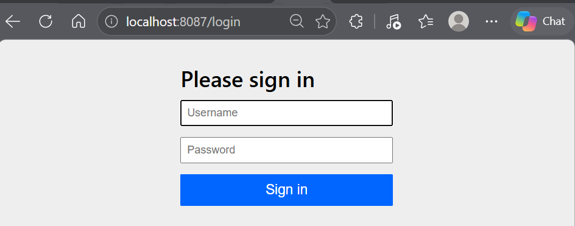
- Configuration de la sécurité : Ajout de la classe SecurityConfig dans le package security qui est annoté @Configuration et @EnableWebSecurity avec un @Bean qui retourne un SecurityFilterChain et injecte un HttpSecurity object pour configurer. Au début demander l'authentification de tous les requetes sauf ceux qui commencent par /api/** et /h2-console/**, puis desactiver le crsf et authentification STATELESS ...
- Test d'accès qui marche :
    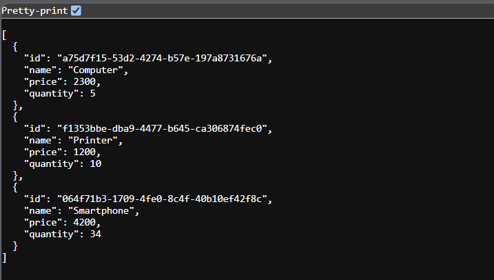

---

#### Création du Frontend

- Création de l'application front Angular
    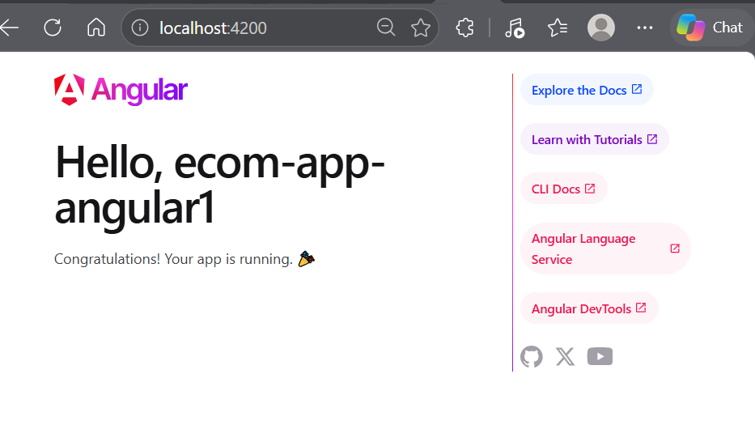
- Création des composantes products et customer puis réglage du routage
- Résolution du problème do Cors en ajoutant un @Bean à la classe SecurityConfig de type CorsConfigurationSource qui marche aussi pour les routes protégé au lieu de @CrossOrigin(*)
    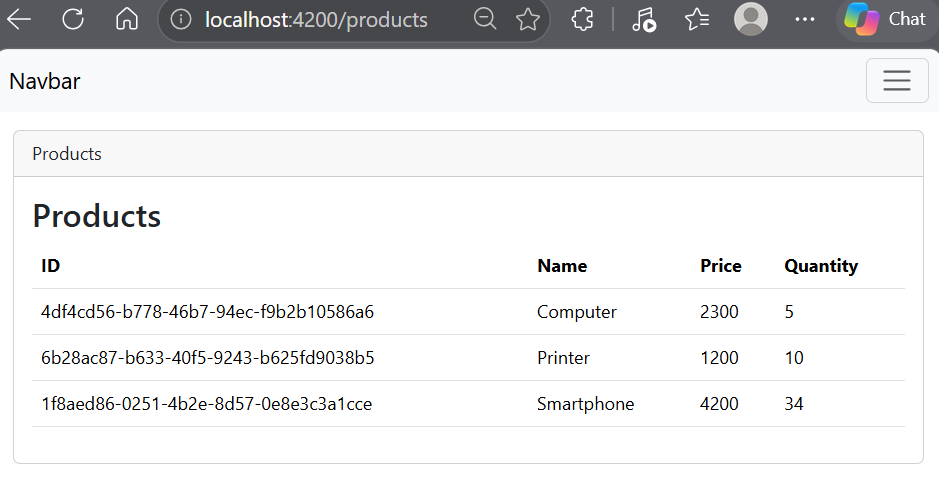
- Démarrage du keycloak et création du realm : Bdcc-realm et client ecom-client-ang avec deux roles user et admin et deux users
    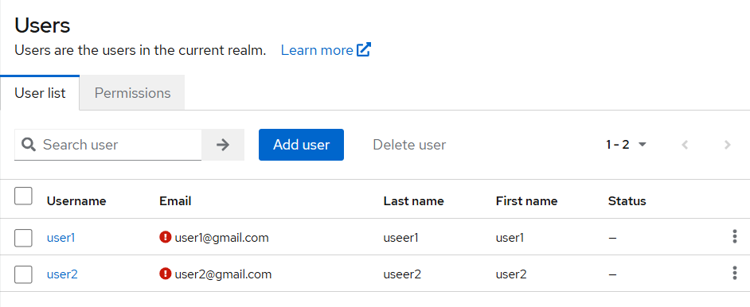
    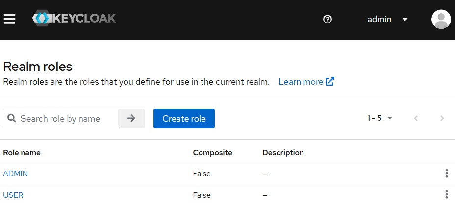
    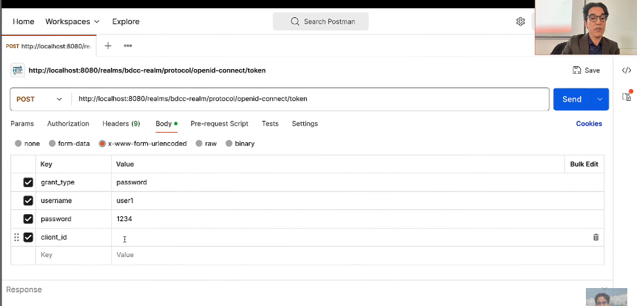
    * Authentification avec uername&password
    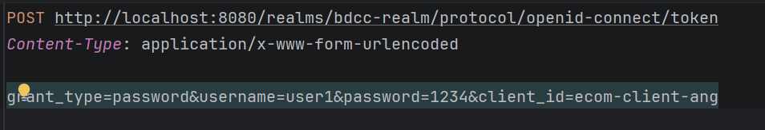
    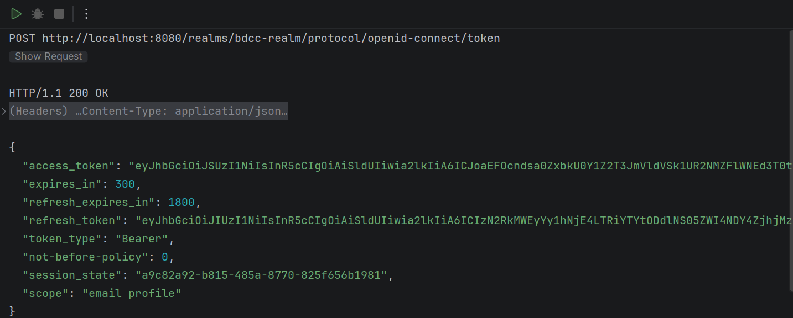
    * Authentification avec refresh token
    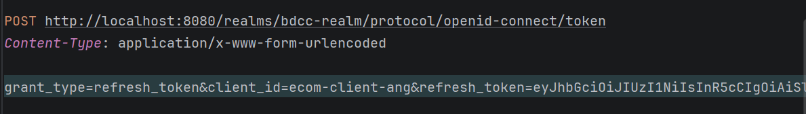
    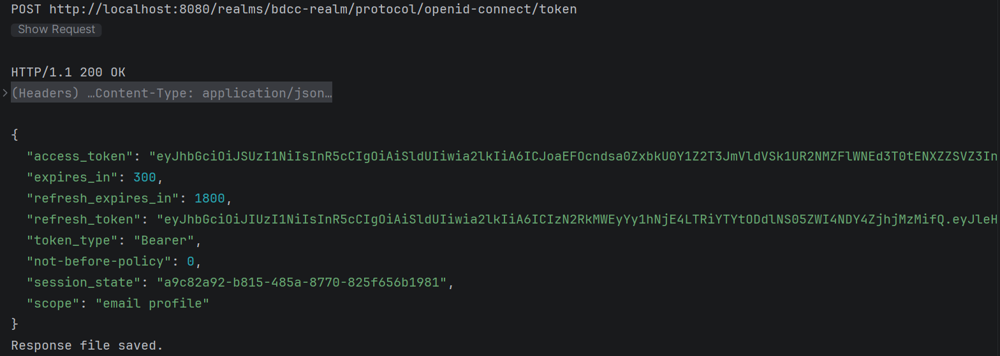
    * Authentification avec client secret
    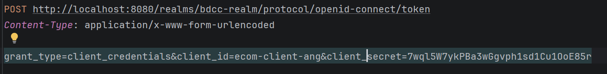
    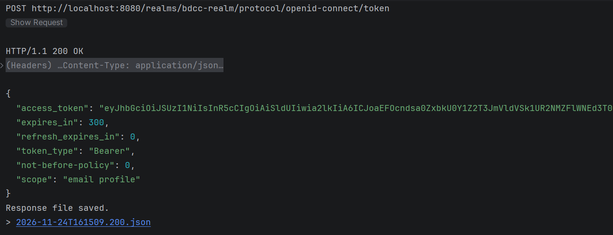

- Configuration de l'authorization en demandant l'authentification dans SecurityConfig au backend
- Ajout des paramètres du keycloak (realm , lien de la certif) pour l'accès au public key 
- Création d'une classe qui fera un JWTConversion dans security package pour accéder aux autorités puis configurer le SecurityFilterChain à utiliser le jwtConverter
- Ajout du @PreAuthorizze dans les méthodes du RestController pour attribuer les roles et pour que cela marche; l'ajout du @EnableMethodSecurity dans la classeSecurityConfig
    
